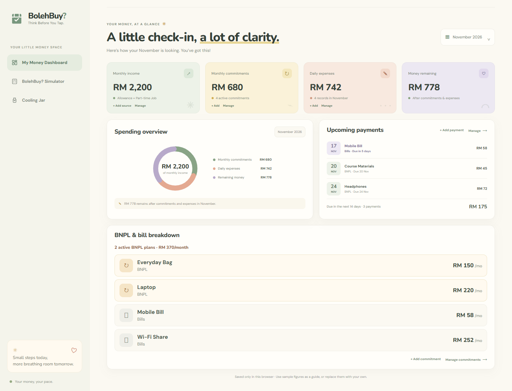
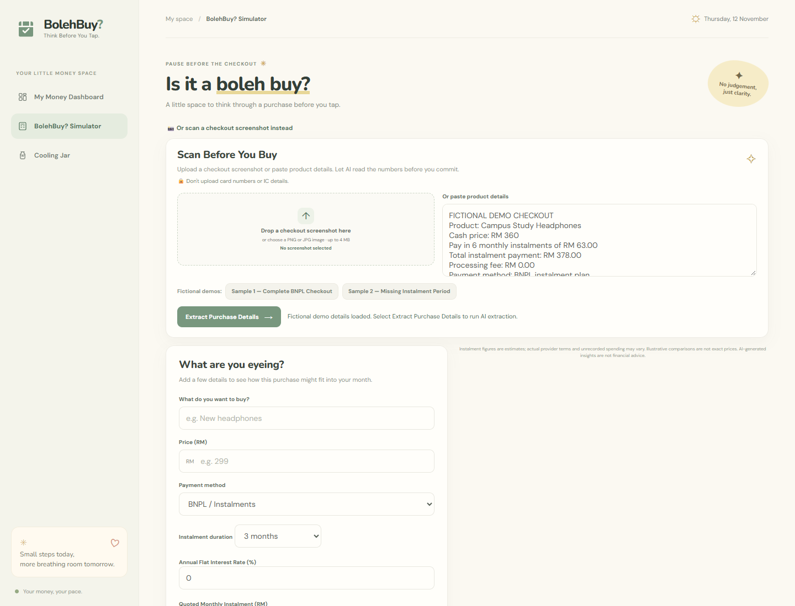
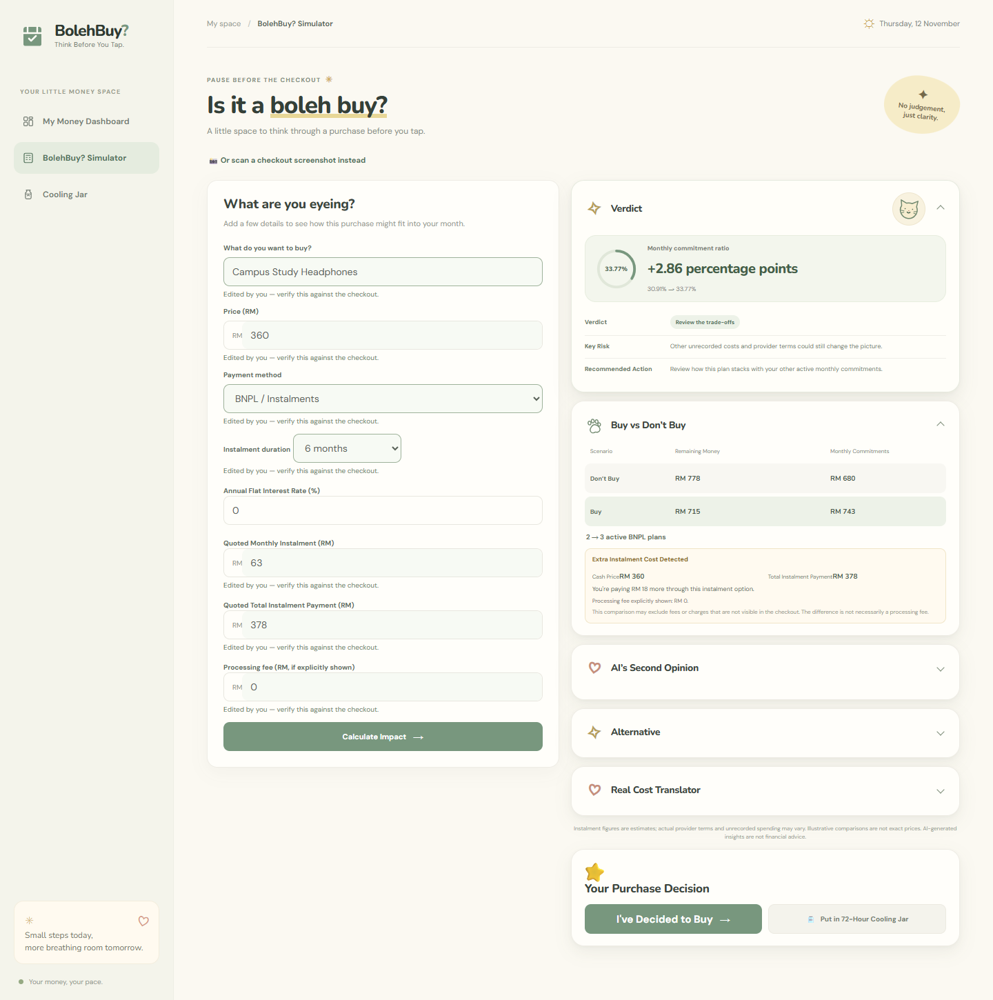
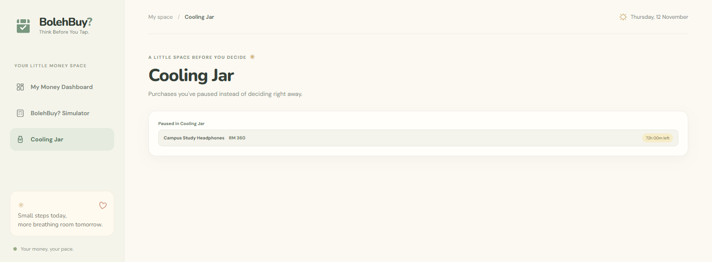
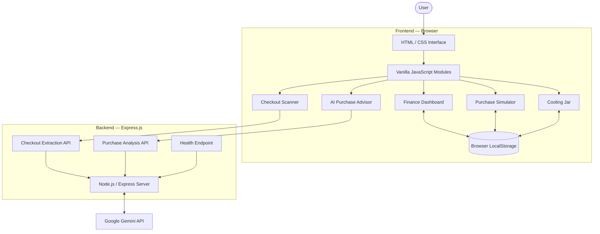
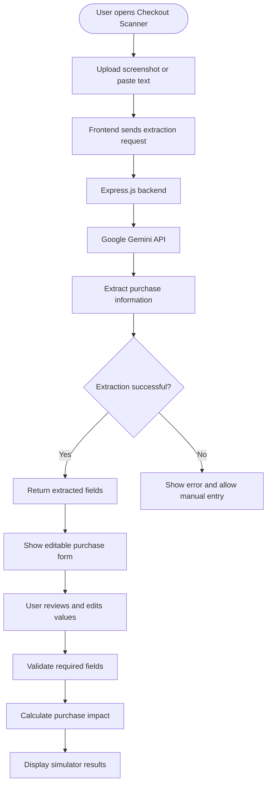
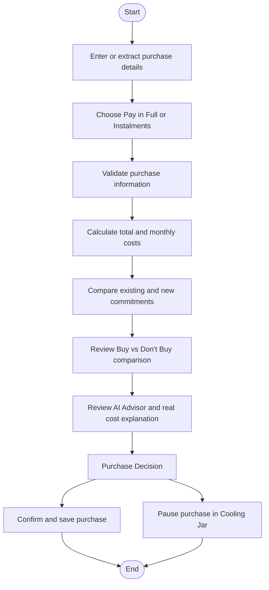

# BolehBuy? — Think Before You Tap

> An AI-powered purchase decision assistant that helps Malaysian youth understand the real financial impact of buying something before checking out.

## Product Showcase

### Your money, at a glance

Track income, spending, upcoming payments and active BNPL commitments in one dashboard.



<details>
<summary>Explore the purchase decision flow</summary>

### 1. Scan before you buy

Upload a checkout screenshot or paste product details, then review the extracted values before calculating.



### 2. See the purchase impact

Compare buying with waiting and see how a new instalment changes your monthly commitments.



### 3. Take a pause with the Cooling Jar

Save a purchase for a 72-hour cooling period before deciding.



</details>

*Screenshots use sample finances and a fictional purchase. The simulator shows the app's local analysis; live AI features require a configured Gemini API key.*

## Overview

BolehBuy? is a personal finance decision-support application designed for Malaysian students and young adults.

With the growing popularity of Buy Now, Pay Later (BNPL) services and instalment payments, young consumers may underestimate how multiple small monthly payments accumulate into a significant financial commitment.

BolehBuy? helps users understand what they are committing to before making a purchase.

**Our goal:** Help users think before they tap checkout.

## The Problem

Online shopping and BNPL services make purchasing easier than ever. However, consumers may overlook:

- The total cost of instalment purchases.
- Additional costs associated with instalment payments.
- How multiple BNPL plans accumulate into monthly commitments.
- Whether a purchase fits their existing financial situation.
- The difference between paying in full and paying over time.

BolehBuy? addresses these problems by turning purchase information into understandable financial insights.

## Key Features

### 1. Personal Finance Dashboard

A centralised view of the user's financial situation.

- Track income and monthly commitments.
- Record daily expenses.
- Manage upcoming payments.
- View monthly financial summaries.
- Monitor active BNPL commitments.
- Track commitment durations and payment status.

### 2. AI Checkout Scanner

Understand a purchase without manually entering every detail.

- Upload a checkout screenshot.
- Paste product or checkout information.
- Use demo examples to explore the feature.
- Extract relevant purchase information using Google Gemini.
- Review and edit extracted values before calculating.

The scanner assists with data extraction. Users remain responsible for reviewing the information before proceeding.

### 3. Purchase Simulator

Compare different payment methods before purchasing.

- Pay in Full.
- Instalment payments.
- Custom instalment terms.
- Monthly payment calculations.
- Estimated total instalment cost.
- Comparison between cash price and instalment cost.

### 4. BNPL Commitment Snowball

Understand how a new instalment affects existing financial commitments.

The simulator compares:

- Existing monthly commitments.
- Monthly commitments after the purchase.
- The difference created by the new purchase.
- Active BNPL plan counts before and after the purchase.

This helps users understand how multiple small instalments can accumulate over time.

### 5. AI Purchase Advisor

Receive an additional perspective before making a purchase.

The advisor provides a purchase analysis based on the available financial information and purchase details.

### 6. Mamak Kakak Honest Mode

A more conversational way to understand the purchase decision, using straightforward explanations rather than complicated financial terminology.

### 7. Cooling Jar

A simple pause-before-buying feature.

Users can temporarily place a purchase into the Cooling Jar instead of immediately committing to it.

The feature stores paused purchase information locally and tracks the 72-hour cooling period.

---

## System Architecture

BolehBuy? uses a client-server architecture.



### Architecture Explanation

| Component | Responsibility |
|---|---|
| Frontend | Displays the application interface and handles user interactions. |
| JavaScript Modules | Handle application logic, calculations, validation and feature workflows. |
| LocalStorage | Stores personal finance records and Cooling Jar data in the browser. |
| Express.js | Handles backend API requests and communicates with Gemini. |
| Google Gemini API | Supports checkout information extraction and AI purchase analysis. |

**Important:** Personal finance records are stored locally in the browser. The AI features send the information needed for their respective analysis requests to the backend.

## Checkout Scanner Data Flow



The AI extraction process does not automatically confirm or save a purchase. Extracted values must be reviewed before calculations are performed.

## Purchase Decision Flow



## Technology Stack

| Technology | Usage |
|---|---|
| HTML5 | Application structure |
| CSS3 | Styling and responsive layouts |
| JavaScript (ES Modules) | Frontend logic and calculations |
| Node.js | Backend runtime |
| Express.js | Backend API |
| Google Gemini API | AI-powered extraction and purchase analysis |
| LocalStorage | Local financial data persistence |
| npm | Dependency and script management |

## Project Structure

```text
First-cc/
│
├── index.html
├── styles.css
├── server.js
├── package.json
├── .env
├── .gitignore
│
├── js/
│   ├── dashboard.js
│   ├── storage.js
│   ├── calculations.js
│   ├── simulator.js
│   ├── checkout-scanner.js
│   ├── ai-advisor.js
│   ├── advisor-analysis.js
│   └── cooling-jar.js
│
└── tests/
    └── ...
```

*The structure above reflects the known application modules. Update it if the actual repository contains additional or renamed files.*

## Installation & Setup

### Prerequisites

- Node.js
- npm
- Google Gemini API key

### 1. Clone the Repository

```bash
git clone YOUR_REPOSITORY_URL
cd First-cc
```

### 2. Install Dependencies

```bash
npm install
```

### 3. Configure Environment Variables

Create a `.env` file in the project root:

```env
GEMINI_API_KEY=your_gemini_api_key
```

Keep your API key private. Never commit `.env` to GitHub.

### 4. Start the Development Server

```bash
npm run dev
```

Open the application:

```text
http://localhost:3000
```

Keep the terminal running while using the application.

## API & AI Integration

BolehBuy? uses Google Gemini through its Express.js backend.

The backend is responsible for:

- Loading the Gemini API key from environment variables.
- Sending supported extraction and analysis requests.
- Processing AI responses.
- Handling errors and returning appropriate responses to the frontend.

The API key is kept on the server side rather than exposed in frontend JavaScript.

AI-generated information is treated as assistance, not as the source of truth for financial calculations.

## Data Storage & Privacy

BolehBuy? uses browser LocalStorage for personal financial records.

- Financial records are stored locally in the user's browser.
- Cooling Jar entries are stored separately.
- Users can manually review and manage their records.
- Gemini requests are handled through the backend.
- API credentials are not included in frontend code.

AI requests should only include the information needed for the requested feature.

## Testing

Run the automated test suite:

```bash
npm test
```

Check JavaScript syntax where applicable and review changes before committing:

```bash
git diff --check
```

The project has previously passed a 50-test suite before subsequent UI and diagnostic work. Run the current suite again to verify the latest repository state.

## Current Limitations

- AI extraction and analysis depend on Gemini API availability.
- Gemini may temporarily return errors such as HTTP 503 during periods of high demand.
- Extracted checkout information requires user review.
- The application is a decision-support tool, not a banking or financial institution.
- Financial records are currently stored in browser LocalStorage rather than a cloud database.
- Smart Dupe recommendations should not be interpreted as verified live product listings unless connected to a reliable product data source.

## Future Improvements

- More reliable AI extraction with retry and fallback handling.
- Verified lower-cost product alternatives.
- Improved financial insights and spending analysis.
- More comprehensive BNPL tracking.
- Optional secure cloud synchronisation.
- Expanded financial education for Malaysian youth.

## Project Vision

BolehBuy? is built around one simple idea:

**Before you buy something, understand what it really costs you.**

Think before you tap. Make every purchase a more informed decision.
